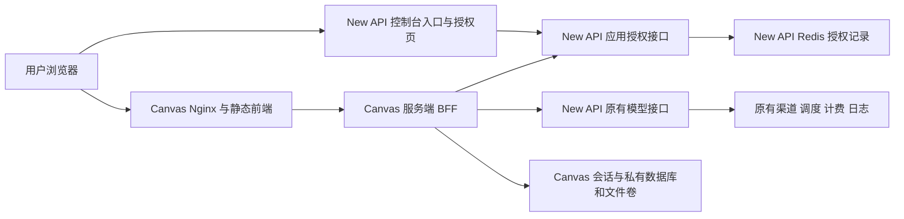

# Infinite Canvas 集成技术设计与文件改动计划

## 当前阶段与结论

源码调查与文件计划先行完成，经用户确认后已实施本地集成：New API 的可配置入口、一次性码授权和受管凭据；Canvas 的独立 BFF、用户会话、私有持久化与网关调用。两个项目保持独立仓库、独立服务、独立数据和独立发布。模型调用继续进入现有 New API 鉴权、分组、路由、限流、计费和日志链路。具体已实现契约、部署配置与实际验证见[第十节](#implementation-status)。Docker 与真实厂商端到端验收尚未完成，不能据本地构建宣称全部验收通过。

调查日期为 2026-10-21（Asia/Shanghai）。New API 基线为 `main` / `d10f728f0`；Infinite Canvas 基线为 `main` / `9f2bd9f1b27c45fd1b8f5323072b07243f9e0fac`，根 `VERSION` 为 `v0.20.0`。调查开始时两个工作区均无未提交改动。下文一至九节保留实施前的源码证据和方案；“拟新增”表述属于原计划，最终文件、字段和接口以第十节及当前源码为准。

画布的 `origin` 保持 `https://github.com/JasonWangJie/infinite-canvas.git`，本轮已在本地增加 `upstream=https://github.com/basketikun/infinite-canvas.git`，未 fetch、merge 或 push。保留 MIT 的 `Copyright (c) 2026 basketikun`、原作者链接和包归属；New API 的 new-api / QuantumNous 署名及许可证不变。

## 一 已核实的 New API 实现

| 范围 | 实际源码与行为 |
| --- | --- |
| 技术栈 | 根 `go.mod` 声明 Go 1.25.1、toolchain Go 1.26.8；Gin、GORM。`web/package.json` 为 React 19、TypeScript、Rsbuild 2、TanStack Router/Query、Zustand、Base UI/Tailwind 4，使用 Bun |
| 用户身份 | `middleware/auth.go` 的 `UserAuth`、`GetSessionAuthIdentity` 区分浏览器登录会话和 PAT；`service/auth_token.go` 的身份包括用户、SID、用户安全版本和会话版本。授权必须取得真实浏览器会话，单独的 PAT 不能替代 |
| 会话有效性 | `service/auth_session.go:130` 的 `ValidateLoginSession` 校验 SID、用户、状态、到期、`UserAuthVersion`、`SessionVersion`；退出和安全版本变化已有撤销基础。必须保存授权当时的版本快照，不能用 `ValidateSessionReference` 在以后重新读取版本来升级旧授权 |
| API Key | `model/token.go` 的 `Token` 已有 `UserId`、Key、有效期、状态、额度、模型限制、Group、AutoGroups；没有应用和 SID 绑定。`controller/token.go` 的创建、查询、显示完整 Key、批量显示、修改、删除为独立管理路径 |
| 扣费用户 | `middleware/auth.go` 的 `TokenAuth` → `SetupContextForToken` 以 `Token.UserId` 设置上下文；`relay/common/relay_info.go` 构造 RelayInfo。Canvas 不得从请求体、查询或身份头选择扣费用户 |
| 模型列表 | `router/relay-router.go` 的 `GET /v1/models` 经过 TokenAuth；`controller/model.go:218` 的 ListModels 取当前可用组、Token 模型限制及计费配置交集，SelfUseMode/用户允许未定价模型时遵循原例外。`GET /v1/models/:model` 的静态查找不能代替权限判断 |
| 分组与路由 | `TokenAuth` 验证用户状态和 Token 分组资格；`middleware/distributor.go` 决定实际渠道；`service/group.go` 实现用户可用组。新集成不允许 Canvas 自选任意 Group、渠道或管理员身份 |
| 计费与日志 | 现有 relay 和 billing session 执行预扣、结算、退款及日志。Canvas 只记录自己生成记录与网关 request/task ID，不另设价格表或客户端扣费公式 |
| 配置与导航 | `model/option.go`、`controller/option.go`、`controller/misc.go` 管理配置与公开状态；`web/src/features/system-settings/` 有共享设置表单；`web/src/hooks/use-sidebar-data.ts`、`use-sidebar-config.ts` 管理入口和菜单可见性 |
| Docker | 根 `Dockerfile` 分别用 Bun 和 Go 构建，最终运行独立 Go 服务，包含内嵌前端；已有 Compose、Redis、数据库和 fork 部署脚本。本轮没有执行这些部署脚本 |

**需要补齐的授权边界：** 普通模型 Key 不随浏览器退出自动失效；只让画布先查一次会话，不能防止泄露的 Key 绕过画布直打网关。完整 Key 显示和普通 Token 修改也必须覆盖受管凭据。`middleware/cors.go` 有全来源配置，新授权接口必须使用明确的来源策略并验证响应头，不能照搬到凭证接口。

## 二 已核实的 Infinite Canvas 实现

| 范围 | 实际源码与行为 |
| --- | --- |
| 技术栈 | `web/package.json`：Vite 7、React 19.2.5、React Router 7、Ant Design 6、Tailwind 4、Zustand 5、axios/fetch、localforage。主站 web 没有独立业务后端或厂商 SDK；canvas-agent 另依赖 @openai/codex |
| Docker | 根 `Dockerfile` 用 Bun 1.3.13 构建，最终只有 Nginx 1.27；`docker-compose.yml` 默认拉原作者 `latest` 镜像，`docker-compose.local.yml` 才构建本地源码；没有画布服务端持久卷 |
| 现有用户模块 | `web/src/stores/use-user-store.ts` 只有空用户状态与清理动作；`web/src/router.tsx` 无授权守卫，不能视为已有登录能力 |
| 模型配置 | `web/src/stores/use-config-store.ts` 保存渠道地址、API Key、模型、格式及本地代理，Zustand persist 默认落 localStorage。模型能力有名称猜测规则，仅用于界面分类 |
| 文本 | `web/src/services/api/image.ts` 的 requestImageQuestion 默认使用 `POST /v1/responses` SSE；另有 Gemini streamGenerateContent |
| 图片与模型 | 同文件的 requestGeneration → `POST /v1/images/generations`；requestEdit → multipart `POST /v1/images/edits`，单图为 `image`，多图为 `image[]`；fetchChannelModels → `GET /v1/models`。另有 Gemini 原生图片分支 |
| 蒙版编辑 | `web/src/pages/canvas/project.tsx` 当前把原图和蒙版作为两张参考图并配提示词，不是标准 multipart `mask` 语义，不能据此宣布标准 inpainting 已兼容 |
| 视频与音频 | `web/src/services/api/video.ts` 有 `POST /v1/videos`、`GET /v1/videos/:id`、`GET /v1/videos/:id/content`；另有 Gemini predictLongRunning。`audio.ts` 有 `/v1/audio/speech`。需逐项验证网关支持，不能把任意 Google 原生视频路径当成已有网关能力 |
| 素材上传 | `services/image-storage.ts` 的 uploadImage、`file-storage.ts` 的 uploadMediaFile 写浏览器 IndexedDB 并返回 object URL；不是服务器上传 |
| 画布持久化 | `lib/localforage-storage.ts`、`stores/canvas/use-canvas-store.ts`、`stores/use-asset-store.ts` 使用全站固定命名；项目和素材没有 owner。图片/视频日志还分别在页面直接访问固定 IndexedDB store |
| 导入导出 | `lib/canvas/canvas-export.ts` 为 version 3 ZIP，包含 projects.json 和二进制；画布/素材导入直接使用 ZIP 内 storageKey。托管后要重新分配 ID 并重写引用，不能把 storageKey 当授权 |
| 同步 | `services/app-sync.ts` 是用户自配 WebDAV 整包同步，不是本项目的多用户云存储；配置还会持久化 WebDAV 凭据 |
| 可复用界面 | `components/layout/model-select-modal.tsx` 已有模型搜索；`components/model-picker.tsx` 是现有调用选择器。应扩展这两处并使用 Ant Design，保留画布主题 |

另有四处必须处理：`components/layout/client-root-init.tsx:20` 支持 URL 导入 API Key；`services/api/video.ts:260` 会将 Gemini Key 拼进媒体 URL；`services/api/model-plugin.ts` 使用 new Function 执行模型脚本；`lib/canvas/plugin-loader.ts` 从任意地址载入同源 JS。`canvas-proxy/` 是任意目标地址、任意 CORS 的本地工具，不能作为公网多用户代理。

`canvas-agent/` 是独立的 loopback Express 服务，调用本机 Codex/Claude CLI，使用自己的 token、工作区和 SSE。它不是现成的画布云后端，也未保证模型请求经过本次用户的 New API 额度。

## 三 目标架构



Canvas 新增 `canvas-server/`，负责单点授权、Cookie、模型列表、固定 AI 接口代理和用户数据。拟使用 TypeScript、Bun、成熟 HTTP 路由库和 Bun SQLite；部署版本及依赖在实施时锁定，不改变 New API 的 Go 依赖和三个数据库方言。画布 SQLite 和文件卷只归画布服务所有，数据库及原始文件目录不暴露到 Nginx 静态目录。

浏览器只访问 Canvas 同源服务；网关地址来自服务端配置，不能由浏览器提交目标 URL。两服务之间通过私网或 HTTPS 通信，保持独立镜像及备份。New API 不接收画布项目 JSON 或素材存储职责。

### 3.1 单点授权流程

1. New API 增加内部入口 `/canvas`，导航到管理员配置的 Canvas `/auth/start`。BFF 生成登录事务、state 和 PKCE S256，服务端保存 verifier，给浏览器设置只含随机事务标识的 Cookie。
2. BFF 跳转固定 New API `/canvas/authorize` 页面，仅传 client_id、state、code_challenge；New API 页面使用当前浏览器已有登录身份向本域授权 API 发 POST。未登录时先走现有登录流程。
3. New API 用 GetSessionAuthIdentity 及 ValidateLoginSession 验证真实用户，绑定已注册应用、精确 callback、PKCE、SID、用户与会话安全版本快照，生成高熵短期码。忽略并拒绝客户端指定的 user_id、额度归属或管理员身份。
4. 固定 Canvas callback 接收 code/state，验证登录事务 Cookie 与 state。只有 Canvas 后端可以用应用凭据及 verifier 兑换；客户端密钥、verifier、网关 Key 不进入浏览器 URL。
5. 原子消费通过验证的授权码，发行受管用户 Token，建立应用授权记录。BFF 将凭据留在服务端，旋转登录事务为新的 Canvas 会话 Cookie，再 303 到不含授权参数的画布首页。
6. callback 和授权相关响应 no-store、Referrer-Policy=no-referrer；回调不加载统计脚本。代理和应用日志不记 code、state、Cookie、Authorization、兑换请求体和可用会话标识。

这是只服务于已注册可信 Canvas 的封闭应用授权协议，不把现有第三方 OAuth 登录回调冒充通用 OAuth/OIDC 授权服务器。应用、callback 和网关地址均为管理员服务端配置，不支持任意动态注册或开放跳转。

### 3.2 一次性码与受管凭据

推荐以 New API 已有 Redis 做共享授权存储，集成启用时强制可用；不降级为单进程 Map。拟新增记录包含码的摘要、client、callback、challenge、父身份快照、状态、到期及授权记录 ID；不存原始码。

通过 Lua/CAS 完成校验和状态切换，不能 GET 后再 DELETE。错误 client/verifier 不得消费他人的码；合法重复兑换必须拒绝，并撤销该码已经发行的授权。保留消费墓碑及关联 grant，不只 GETDEL 后丢失关联。并发中只允许一个发行者，重复兑换与发行完成之间也必须保持撤销状态。SQL 创建失败则本次码失效；Redis 激活失败则 Token 不可用并补偿清理，不在故障时放行。

网关受管凭据仍使用现有 `model.Token` 行，UserId 来自原登录身份，Group 留空跟随当前用户组，不设置客户端自选组或渠道。Token.UnlimitedQuota 只表示没有额外的 Token 子额度上限，用户钱包/套餐、原预扣、结算和限流仍照常生效。

拟保留专用 Key 命名空间 `ic_`，并在 Redis 将 Key 摘要、Token ID、应用、父 SID、授权时 uv/sv 和到期绑定。源码核实 GenerateKey 当前仅生成字母数字，不包含下划线；现有 TokenAuth 会按连字符拆分，因此专用标识不能使用连字符。可信标识来自服务端 Key 命名空间与授权记录，不能来自可编辑 Token.Name。

受管凭据校验为共享安全边界：授权记录有效、Token ID/用户匹配、应用启用、应用客户端证明有效、原始身份快照仍有效，然后继续原认证及后续中间件。必须同时覆盖 `TokenAuth`、`TokenAuthReadOnly` 和其他读取 Token 的入口；未列入应用允许范围的 token usage/log/stats 等路径拒绝受管 Key。`router/async-image-router.go` 的图片提交、上传及查询使用 TokenAuthReadOnly，不能只修改普通 TokenAuth。受管 Token 仅允许经过已认证应用访问批准路径；浏览器传入的同名应用证明由 BFF 丢弃。即使 Key 泄露，缺少应用证明或父会话失效也不能绕过授权。应用证明用成熟认证库/常量时间校验，不自创加密算法。

网关验证应用证明后立即从入站请求头删除它，只把非秘密验证结果写入 context，必须在 RelayInfo 克隆请求头之前完成。现有 `relay/channel/api_request.go` 支持星号/正则头透传及 client_header 复制，`relay/common/relay_info.go` 会保存入站头；不能让应用 secret 通过这些既有功能流到厂商、参数或错误日志。原有普通请求头透传合同无需重写，新增证明头本身禁止进入该链路。

`MediaObjectContent` / validateMediaToken 和 `GetImageObjectContent` 的签名读取不经过上述 TokenAuth；必须逐项处理，不能漏作旁路。受管媒体只通过当前有效 grant 的应用内容桥向 Canvas 提供，原公共媒体签名不能替代 Canvas 会话。媒体对象可由原 Token 找到应用绑定；图片存储对象自身没有 owner/TokenId，需要经任务/上传意图关联核实归属，不能伪造一个现有 owner 字段。受管结果不向浏览器暴露原网关签名地址；向厂商提供的输入链接限定为服务端任务输入用途。普通用户原有签名媒体行为保持原合同，不能为 Canvas 全局放宽或全局关闭。

`controller/token.go` 的单个/批量完整 Key 显示不得返回受管 Key；普通更新不得延长其寿命、改变分组/模型限制或解除应用绑定。用户保留停用和删除授权的能力，旧授权不能通过重新启用普通 Token 复活。原 Token 表字段保持不变；为历史任务增加独立、非秘密的应用关联表，见第四节，必须做真实三库及迁移验证。

Canvas 会话仅保存随机 session secret 的摘要；需要出站调用的网关凭据在服务端加密保存，加密密钥由部署 secret 注入，不进入镜像或 runtime config.js。Redis 丢失记录后现有受管 Key 全部拒绝，用户重新授权；Token 到期及后台清理处理遗留行，不能悄悄重建已撤销授权。

### 3.3 Cookie 撤销与权限变化

- 生产 Cookie 使用 `__Host-`、Secure、HttpOnly、Path=/、SameSite=Lax，无 Domain；SameSite 支持跨站顶层 GET 回调，不替代 CSRF。登录成功更换随机会话，不接受 URL 会话令牌。
- Canvas 写接口校验精确 Origin 和会话绑定 CSRF token，包括上传、编辑、删除、退出及付费 AI 请求；校验跨站/同站不同子域的伪造请求。服务端兑换接口使用应用认证，不开放携带浏览器凭证的跨域调用。
- 每次受保护的数据或 AI 请求校验当前 grant 与父会话；网关也对每次受管 Token 调用校验父身份快照。New API 退出、会话撤销、禁用、密码/安全版本变化、应用停用、用户撤销授权后，后续请求均应失败。
- 当前组和模型权限每次按 New API 的实际规则校验，不把登录时组或前端下拉框当权限。请求模型必须属于当前允许列表；接口类型还需匹配支持能力。隐藏菜单不是鉴权。
- 撤销与安全版本检查包含多实例缓存失效验证；若现有缓存路径不能满足受管授权的撤销保证，受管校验应读权威状态或拒绝请求，不能用旧缓存继续放行。此调整限定在应用授权边界。
- Canvas 退出撤销本次 Canvas grant 和 Cookie，不附带退出用户其他应用。New API 退出使相应父会话派生的 Canvas 授权失效。失效时阻止新付费请求，结束客户端轮询/流并清理页面；已被网关受理的异步任务依原规则继续，不擅自取消、重提或退款。

## 四 AI 接口与异步任务适配

| 能力 | 当前真实网关路径 | 实施边界 |
| --- | --- | --- |
| 允许模型 | `GET /v1/models` | 同一受管 Token 查询；保留端点能力，复用并扩展现有模型选择器搜索；不用静态 retrieve 接口决定权限 |
| 文本与看图 | `POST /v1/responses`；可按需要支持 `/v1/chat/completions` | 先保持 Canvas 现有 Responses SSE 解析；BFF 流式转发，客户端中止不自动重发付费请求 |
| 图片生成 | `POST /v1/images/generations` | 保留 JSON 参数、b64_json/结果语义，生成结果写 Canvas 当前用户素材 |
| 参考图编辑 | `POST /v1/images/edits` | 保留 multipart image/image[]；验证多参考图、MIME 和精确零值。标准 mask 为单独能力用例，不把当前两参考图实现当成标准蒙版 |
| 异步视频 | `POST /v1/videos`、`GET /v1/videos/:task_id`、`GET /v1/videos/:task_id/content` | BFF 创建自己的 owner 任务记录，再转网关。状态查询、Range 播放和下载先验证 owner；不向浏览器泄露 Key |
| 专用异步图片/媒体 | `/v1/images/tasks_async/:id`、`/v1/media/tasks_async/:id` 等 | 当前同时绑定 user_id 和 token_id，Token 轮换后不能直接查询旧任务；必须在第五阶段前实现并测试下述历史访问桥，不能全局放宽原接口 |
| Gemini/音频 | 原有 Gemini relay、`/v1/audio/speech` | 用已核实网关路由逐项适配；不支持的模型/端点明确提示，不回退直连厂商。保留音频节点和导出数据 |

原生视频查询在 `relay/relay_task.go`、视频内容在 `controller/task.go` / `video_proxy.go` 按 UserId 判断，可在同用户重新授权后使用新 Token。专用异步图片/媒体在 `controller/async_image.go:214`、`media_tasks.go:45` 绑定原 Token ID，媒体对象签名还校验原 Token 有效性。拟新增应用专用只读历史桥：当前 Canvas grant 有效、Canvas 登记的任务属于当前用户、网关数据库再次确认 task.UserId 及应用原始授权关联，才提供当前身份可取的内容流；普通 Token 的原公共接口及签名行为不变。这是新增能力，必须审查和三库验证后才允许接入专用异步管线。

为使该关联不随 Redis 会话清理丢失，拟新增 `CanvasGrant` 持久表，保存服务端签发的 Token ID、应用 ID、用户 ID 和签发审计信息，不存 Key、code 或 Cookie。与 Token 创建在同一数据库事务写入；历史桥从任务原 Token ID 关联该表，再与当前有效 grant 的用户/应用匹配。授权撤销、Redis 丢失和旧 Token 到期只使调用凭据失效，不删除历史归属；关联至少保留到引用它的任务、输入与结果对象完成各自保留生命周期，不能跟会话 TTL 删除或因 Token 软删级联丢失。当前表并不存在，需新模型与跨三库幂等迁移。历史恢复不重新激活旧 Key，也不相信 BFF 单方面声明的任意 user_id/task_id。

BFF 只开放固定的 method/path 允许列表，不提供 `/proxy?url=`；剔除客户端 Authorization、Cookie、x-api-key、x-goog-api-key、New-Api-User、组和渠道选择头，重新注入服务端凭据。不能将 Key 跟随外部重定向或以 `?key=` 转发。模型及错误以网关返回为准，明确区分未授权、会话过期、禁用、余额不足、无模型权限、上游参数/生成失败和执行结果未知。

下载优先使用网关 content 接口。网关返回外部媒体 URL 时由服务端登记并验证来源，限制每跳重定向、DNS/IP、协议和凭据转发；浏览器不可提交任意待抓取 URL。结果持久化失败不得自动重复付费生成，生成记录显示“生成结果保存失败”并保留可恢复关联。

## 五 用户数据与插件隔离

Canvas 私有 SQLite 拟保存 users（网关实例标识与授权 subject 映射）、projects、assets、generation_records、plugin_state；实际迁移在实施时创建。每一业务记录必须有服务端 owner，查询、更新、删除和文件读取同时按 owner 与 ID 定位；用户不能通过 JSON 修改 owner。用户 ID 以“New API 实例 + subject”识别，不用用户名、昵称或邮箱作为唯一身份。

项目 JSON 保留 nodes、connections、chatSessions、viewport 及既有扩展字段，增加服务端 revision 处理并发保存；冲突返回明确提示，不能以过期页面静默覆盖新项目。文件名仅用于展示，实际文件 ID 和存储路径由服务端生成，不接受 storageKey 作为真实磁盘路径。文件从鉴权路由读取，不能把整个上传目录公开。

浏览器不再持久化托管画布、素材、生成记录和凭据明文，只保留必要非敏感 UI 偏好及当前会话内存。仅加 userId 的 IndexedDB namespace 不能阻止同源枚举，不能算服务端隔离。授权完成前不 hydrate；退出/账号切换须清定时保存队列、未完成请求、SSE/轮询、Zustand、插件状态和 object URL，防止迟到响应/400ms debounce 写入新用户空间。离线私有项目访问不在这版托管模式能力内。

ZIP 导入重新分配当前用户的项目、素材、文件 ID 并重写引用，不信任包内 owner、storageKey、远端 URL 或执行脚本。保留原版本 3 格式和节点/连线数据的往返；未知插件节点保留原数据并提示其不可执行，不能静默丢弃。导出只包括当前用户可读取资源，不含任何会话、API Key 或服务端配置。

首版建议采用**受管模式**：保留内置节点、工作流、经过渲染安全审查的固定版本画布插件和经 BFF 的 host.ai；普通用户不能新增任意 URL 插件、执行模型脚本、修改网关或启用本地任意转发代理。原本机 Codex/Claude Agent 和任意 WebDAV 同步不直接开放到共享站点。该兼容范围需先确认，不能在实现时静默删除功能。若要求执行任意第三方脚本，需要独立源 sandbox + 受控 RPC 的额外阶段，不能仅靠 HttpOnly/CSP 保护同源恶意脚本。自定义脚本不能自动从导入包运行。

固定版本不等于安全：现有 `plugins/canvas/svg/src/index.tsx` 将 SVG 原文注入 DOM，`plugins/canvas/markdown/src/index.tsx` 动态从 CDN 载入 marked 并把未经净化的结果写 innerHTML。受管模式必须对 HTML/SVG/Markdown 等导入和模型输出使用成熟内容净化/隔离方案，拒绝脚本、事件属性、危险 URL 和外部资源窃取，依赖随镜像固定打包或校验完整性，不能继续从任意 CDN 运行时取代码。未完成安全适配的节点保留数据并用不可执行占位展示；回归必须含恶意 ZIP、SVG/Markdown 和模型输出，验证不能带当前 Cookie/CSRF 调用 BFF。

## 六 文件改动计划

以下为实施计划，不代表本轮已经修改这些业务文件。优先共享服务接入，避免重写画布节点和 New API 核心。

### 6.1 New API

| 路径 | 拟改动 |
| --- | --- |
| 拟新增 `setting/system_setting/infinite_canvas.go` | 入口开关、Canvas 精确地址/client 标识的非秘密配置与校验；客户端秘密从环境或 secret 文件读取 |
| `model/option.go`、`controller/option.go`、`controller/misc.go` | 接入现有配置；公开状态只返回入口可用性与地址，不返回应用秘密 |
| 拟新增 `model/canvas_grant.go`、`model/main.go` 的模型注册 | 非秘密历史应用归属表，Token 与关联事务写入；三库 fresh/upgrade/重复启动及清理关联验证 |
| 拟新增 `service/infinite_canvas.go`、`controller/infinite_canvas.go` | 码发行/兑换、Redis 原子授权、受管 Token 生命周期、introspection/revoke、历史访问桥；按业务概念保持直接结构，不提前建立通用身份平台 |
| `router/api-router.go` 或专用注册文件 | 注册应用授权接口及 Origin、无缓存、限流、认证；与当前 API/relay 的 CORS 作用域明确隔离 |
| `middleware/auth.go`、`middleware/async_stats_auth.go`、`router/async-image-router.go` | TokenAuth/TokenAuthReadOnly/其他 Token 路径共享受管校验或拒绝策略，防只读/统计/上传绕过；普通 Token 合同不变 |
| `controller/token.go`、`controller/async_video.go`、`controller/media_tasks.go`、`controller/async_image.go` | 完整 Key 显示/普通修改保护，签名读取与 validateMediaToken 的受管内容边界；复用原存储读取和 owner 依据 |
| `web/src/hooks/use-sidebar-data.ts`、`use-sidebar-config.ts`、`web/src/stores/system-config-store.ts` | 增加可配置入口，尊重已有管理员与用户菜单开关 |
| `web/src/features/system-settings/site/section-registry.tsx`、`web/src/features/system-settings/site/index.tsx`、`web/src/features/system-settings/types.ts`，拟新增同功能设置 section | 复用 SettingsSection / SettingsForm / SettingsPageFormActions 和 Form/Input/Switch，不另造设置页框架 |
| 拟新增 `web/src/routes/_authenticated/canvas/index.tsx`、`canvas/authorize.tsx` 及对应 feature | 入口跳转和浏览器会话授权页；复用现有认证路由、错误提示和 API 客户端；不得走旧 Chat URL Key 模板 |
| `web/src/i18n/static-keys.ts`、七语 locale | 新文案通过 i18n-translate 脚本及 `bun run i18n:sync`，不手改 locale JSON |
| 既有 auth/token 测试及最多一个新增 Go 集成测试文件 | 聚焦安全协议、权限、三库 Token 生命周期与计费用户，避免在多层复制同一测试 |
| `readmenew.md`、本页、月度台账、Wiki 目录 | 同步已实现范围、实际验证和提交状态；本轮只登记设计 |

### 6.2 Infinite Canvas

| 路径 | 拟改动 |
| --- | --- |
| 拟新增 `canvas-server/package.json`、锁文件、`src/index.ts` 及 SSO/session/gateway/storage 路由和聚焦测试 | 独立 BFF；服务端 owner 数据库、私有文件、Cookie/CSRF、流代理及任务归属。先按职责直接实现，不堆空层次 |
| `web/src/router.tsx`、`main.tsx`、`layouts/user-layout.tsx`、`stores/use-user-store.ts` | 会话 bootstrap 和加载门禁，退出/账号切换清理，受管布局挂载能力 |
| `web/src/components/layout/client-root-init.tsx`、`stores/use-config-store.ts`、`services/config-file.ts` | 托管模式取消 URL Key 导入、凭据和网关自选；配置导入导出不能覆盖服务器策略 |
| `web/src/services/api/image.ts`、`video.ts`、`audio.ts`，拟新增 session/data API 模块 | 同源请求，保持现有返回结构、SSE、JSON、multipart、Blob，统一错误及请求取消 |
| `web/src/components/model-picker.tsx`、`components/layout/model-select-modal.tsx`、`channel-editor-drawer.tsx`、`app-config-modal.tsx` | 复用当前选择器并增加调用时搜索，展示真实允许模型，移除托管模式密钥编辑能力 |
| `web/src/lib/localforage-storage.ts`、`stores/canvas/use-canvas-store.ts`、`stores/use-asset-store.ts` | 切换权威持久化到当前会话 BFF，处理 revision 和旧保存队列 |
| `web/src/services/image-storage.ts`、`file-storage.ts`、`pages/image/index.tsx`、`pages/video/index.tsx`、`services/app-sync.ts` | 私有上传/文件/日志服务；受管模式不共享旧 IndexedDB 与 WebDAV；持久化视频任务恢复 |
| `web/src/services/api/model-plugin.ts`、`lib/canvas/plugin-loader.ts`、`canvas-event-bus.ts`、`stores/canvas/use-plugin-store.ts` | 可信插件策略、host.ai 受控调用及插件私有数据 owner；不继续执行导入的任意代码 |
| `plugins/canvas/svg/src/index.tsx`、`plugins/canvas/markdown/src/index.tsx`、其他 HTML 渲染插件及其构建依赖 | 审查并净化不可信内容，运行依赖随镜像固定打包；不安全节点采用数据保留占位，加入导入/模型输出 XSS 回归 |
| `web/src/lib/canvas/canvas-export.ts`、`pages/canvas/index.tsx`、`pages/assets/asset-transfer.ts` | ZIP 往返保留内容、重新分配 ID、校验资源归属，不依赖用户提供的 storageKey |
| `Dockerfile`、`docker-compose.local.yml`、`nginx.conf`、`web/docker-entrypoint.sh`，拟新增 BFF Dockerfile/Compose 覆盖 | 独立镜像、私网服务、文件与数据库卷、SSE/no-store/回调日志策略；只把非秘密开关写 runtime config |
| `CHANGELOG.md`、现有 progress/todo.mdx、pending-test.mdx | 实施后按 Canvas 自身规则记录变化和待验收项；保留原作者与 MIT，方案阶段无需假写已完成事项 |

### 6.3 拟新增接口与配置契约

New API 拟新增：`POST /api/integrations/canvas/authorize`（浏览器真实会话）、`POST /api/integrations/canvas/exchange`、`/introspect`、`/revoke`（后端应用认证）；专用异步历史只读桥另在相关阶段确定精确路由并测试，不在实现前伪称现有 API。

Canvas 拟新增：`GET /auth/start`、`GET /auth/callback`、`GET /api/session`、`POST /api/logout`、`GET /api/models`、固定 `/api/ai/...` 以及当前用户 projects/assets/files/generations CRUD。写入数据的 owner 只来自服务端 session；禁止客户端拿 user_id 选用户。

拟新增部署项：New API 的入口开关、Canvas URL/client ID、client secret；Canvas 的公开 origin、New API 外部授权 origin、内部 API base、client ID/secret、会话存储连接、凭据加密密钥、私有数据目录。命名在实施时按现有注册约定定稿，当前不存在这些配置；不把 New API 管理员 Key 或厂商 Key 当应用 secret。地址可以用本地隔离测试值，生产域名及证书只在后续部署阶段按实际环境填写。

## 七 实施顺序与验收门槛

1. **本轮设计**：已完成源码调查、原作者 remote 和本计划；没有实施业务功能。
2. **入口和最小调用**：实现 code/state/PKCE、受管凭据完整撤销链、Cookie、当前用户模型列表、Responses SSE 和单张生图；隔离测试中可调用，不开放共享生产数据。
3. **图片与计费**：打通多参考图编辑和错误映射，核对成功、上游拒绝、输入失败、超时/取消、结果保存失败的实际账务与用户归属；受理未知不自动重试付费。
4. **用户隔离与部署制品**：实现 owner 存储、文件访问、导入导出、会话与插件策略；准备两项目独立 Docker 构建和回滚，不发布。
5. **完整验收**：文本、图片、视频及专用异步桥，双用户、权限/安全版本变化、并发兑换/保存、会话失效、账务与日志、独立升级恢复。未通过安全隔离前不将第二阶段演示称作完整集成。

| 验证组 | 必须证明的行为 |
| --- | --- |
| 授权 | 错码、到期、client/callback/PKCE/state 错误、事务 Cookie 缺失、并发兑换、有效码重放及关联撤销、SQL/Redis 部分失败；URL 无长期凭证；普通/只读/统计/上传/签名访问均不能绕过受管边界 |
| 会话与 CSRF | Cookie 属性和旋转、Origin/CSRF 缺失与伪造、退出/禁用/安全版本升级后直接使用旧 Key 仍失败，包括多实例缓存；Redis 丢记录及应用停用拒绝请求；星号/正则头透传、client_header 复制和日志均不含应用证明 |
| 用户和模型 | A/B 越权项目/文件/任务/导出、伪造 user_id/身份头/组、未授权模型和能力、切换账号迟到保存、旧本地数据不 hydrate |
| 图片与视频 | JSON 生图、单图/多图编辑、蒙版语义、视频异步/跨会话恢复/内容 Range、未知执行不重提、失败账务及日志对应正确用户/模型 |
| 原功能 | 节点/连线/助手、可信插件、ZIP 往返、素材读删、并发 revision；不执行包内任意脚本、不丢弃未知节点数据；SVG/Markdown/HTML 内容净化和同源 XSS 回归 |
| 数据库 | New API 实际 SQLite、MySQL >=5.7.8、PostgreSQL >=9.6，记录精确版本/命令；验证 Token 创建、禁用/删除/清理及原计费。新增 CanvasGrant 必须 fresh + 最新发布版本代表库升级、重复启动和约束保留；授权过期/撤销、Redis 丢失或清理后，历史归属仍在而旧 Key 不可用 |
| 构建与部署 | New API Go/前端检查；Canvas web/BFF 的既有与新增测试、typecheck/build；真实 Docker 独立构建、服务重启持久化、SSE、备份恢复和版本回退。涉及 relaykit 才额外执行其独立 GOWORK=off build |

当前 PATH 能发现 Go、Bun、Node；Canvas web/BFF 尚未安装依赖，未发现 Docker、mysql、psql 客户端。此事实不等于所有远程测试实例都不存在；本轮未连接数据库或执行构建测试，实施前须准备隔离的真实三库和 Docker 环境。没有这些验证时不能宣称数据库兼容、可部署或完成全部验收。真实上游付费验收单独使用明确测试账户与预算，不把模拟上游结果当成真实厂商验收。

## 八 拟议边界与待确认项

Canvas 仓库 `AGENTS.md` 明确要求：“新增或调整超时、重试次数、大小限制、并发上限等会改变实际行为的边界值前，必须先向用户说明适用环节、默认值和失败后的处理方式，并取得确认”。用户已确认以下值及可信固定插件的托管范围，实施按此执行。

| 环节 | 拟议默认值 | 到期或失败行为 |
| --- | --- | --- |
| 单次授权码 | 60 秒，一次使用 | 拒绝兑换，重新从 New API 入口授权；合法重放撤销已关联授权 |
| 登录事务 | 5 分钟 | 丢弃未完成事务和 verifier，重新开始，不发行会话 |
| Canvas 登录会话 | 最长 8 小时，并且不超过父 New API 会话到期；30 分钟无用户活动失效 | 拒绝新 AI/数据请求，保留服务器项目与已受理任务，重新授权后恢复查看；后台轮询不延长空闲寿命 |
| 付费请求自动重发 | BFF 不新增自动重发 | 网络失败或受理未知时展示状态并查询原任务，沿用 New API 原调度/重试，不自动再扣一次 |

上传、导入解压、SSE、媒体下载和并发的具体数值须结合当前网关/存储已有边界及隔离测试再给方案，不在实现中静默增加经验值。网关已有图片数量、视频时长、max_tokens 和额度饱和校验继续复用。

已确认托管模式采用可信固定插件、关闭任意模型脚本/本地代理/本机 Agent 与任意 WebDAV。已有未知节点数据保留，任意导入脚本不执行；第三方任意脚本沙箱留待独立需求。用户数据隔离与所有 AI 经网关的验收标准不降低。

## 九 安全依据与发布边界

设计依据为当前稳定版 [OWASP ASVS 5.0.0](https://asvs.owasp.org/)；已核实固定发布源 `v5.0.0_release`，不是 master/bleeding-edge。对应要求包括 [V3](https://github.com/OWASP/ASVS/blob/v5.0.0_release/5.0/en/0x12-V3-Web-Frontend-Security.md) 的 3.3.1–3.3.4（Cookie）、3.4.2/3.4.5（CORS/Referrer）、3.5.1/3.5.3/3.5.4（CSRF/方法/源隔离）；[V7](https://github.com/OWASP/ASVS/blob/v5.0.0_release/5.0/en/0x16-V7-Session-Management.md) 的 7.2.2/7.4.1（动态会话/失效）；[V8](https://github.com/OWASP/ASVS/blob/v5.0.0_release/5.0/en/0x17-V8-Authorization.md) 的 8.4.1（跨租户隔离）；[V10](https://github.com/OWASP/ASVS/blob/v5.0.0_release/5.0/en/0x19-V10-OAuth-and-OIDC.md) 的 10.1.2/10.2.1/10.4.1/10.4.2/10.4.3/10.4.6（事务绑定、精确回调、单次码及重放撤销、短有效期、PKCE）；[V16](https://github.com/OWASP/ASVS/blob/v5.0.0_release/5.0/en/0x25-V16-Security-Logging-and-Error-Handling.md) 的 16.2.5/16.3.1/16.3.2（秘密保护和安全审计）。这里是适用控制映射，不是合规验收结论。

同时采用 [Authentication](https://cheatsheetseries.owasp.org/cheatsheets/Authentication_Cheat_Sheet.html)、[Session Management](https://cheatsheetseries.owasp.org/cheatsheets/Session_Management_Cheat_Sheet.html)、[OAuth2](https://cheatsheetseries.owasp.org/cheatsheets/OAuth2_Cheat_Sheet.html)、[CSRF Prevention](https://cheatsheetseries.owasp.org/cheatsheets/Cross-Site_Request_Forgery_Prevention_Cheat_Sheet.html) 的相关指导。日志记录事件类型、结果、非秘密用户/应用标识和请求关联；不记录密码、完整 Key、授权码、verifier、会话或刷新令牌。

本轮未提交、未推送、未发布，未连接或写入生产系统。后续代码完成也只做本地修改、隔离构建和制品准备。发布前另行说明准确环境、双方版本、范围、是否重启/停机、新请求影响、窗口、验证和回退，并取得当次明确发布命令。独立回滚优先停用新入口及应用授权，再按锁定镜像与数据快照恢复各服务；停止/重启/回滚生产服务同样需要授权，不能作为本轮准备工作执行。

**退回集成前旧 New API 的额外前置条件：** 旧版本没有 `ic_` 应用证明和父会话守卫，会把仍启用的受管行当作普通 Token。必须先在新版本侧由受信维护流程禁用所有受管 Token、使对应 Key 缓存失效并验证拒绝调用，同时保留 Token ID 和历史关联；只隐藏入口、修改 `infinite_canvas.enabled` 或删除 Redis grant 都不足以保证旧版本安全。此为部署时必须准备并复核的维护步骤，本轮未执行。不要通过恢复整个旧主库来无条件抹去备份后的计费数据。Canvas 回退则先停止写入，按匹配 schema 的私有 SQLite（含 WAL 一致性）和文件快照恢复，密钥与数据一并备份；这些真实恢复步骤仍待 Docker 环境验证。

<a id="implementation-status"></a>

## 十 已实现契约与本地验证

### 10.1 配置与独立部署制品

New API 管理员在「系统设置 → 站点 → AI 无限画布」填写完整 Canvas origin 和应用 ID，再启用入口。应用 secret 只通过 New API 的 `INFINITE_CANVAS_CLIENT_SECRET` 环境变量注入，至少 32 字符，不从选项 API 返回；必须有可用 Redis。公开 `/api/status` 仅增加 `infinite_canvas` 的 `enabled`、`url`、`client_id`。新入口也遵循已有管理员和个人菜单可见性。设置复用 `SettingsForm`、`useSettingsForm`、导航脏表单保护和既有保存动作；授权状态页复用 `Main`、`Empty`、`Button` 与 `Spinner`，没有新造通用表单或弹窗。

| 所属 | 当前源码配置名 | 用途 |
| --- | --- | --- |
| New API 选项 | `infinite_canvas.enabled`、`infinite_canvas.url`、`infinite_canvas.client_id` | 默认禁用；URL 为 HTTPS origin，无路径、用户名、查询或 fragment；仅 loopback 本地开发允许 HTTP |
| New API 环境 | `INFINITE_CANVAS_CLIENT_SECRET` | Canvas 应用独立随机 secret；不是管理员 Key、模型 Key 或厂商 Key |
| Canvas BFF 环境 | `CANVAS_ORIGIN` | 与上述 URL 完全一致的公开 origin |
| Canvas BFF 环境 | `NEW_API_URL`、`NEW_API_PUBLIC_URL` | 分别为服务端可达网关和浏览器授权站点的 base URL，均不含 `/v1`；内部地址允许私网 HTTP，外部地址要求 HTTPS，loopback 开发除外 |
| Canvas BFF 环境 | `NEW_API_CLIENT_ID`、`NEW_API_CLIENT_SECRET` | ID 默认 `infinite-canvas`，必须与网关注册值一致 |
| Canvas BFF 环境 | `CANVAS_SESSION_ENCRYPTION_KEY` | 独立随机 32 字节密钥的 base64 编码，用 AES-GCM 加密服务端需要使用的凭据；须随私有数据安全备份，不能放进浏览器 runtime config |
| Canvas BFF 环境 | `DATA_DIR`、`PORT` | 私有数据库与文件目录；BFF 端口默认 3001，Compose 私网使用此端口 |
| Canvas Compose 环境 | `CANVAS_PROXY_READ_TIMEOUT` | 必填部署值，按现有网关流式/生图时长明确配置；未擅设经验值 |

Canvas 新增 `canvas-server/Dockerfile` 和 `docker-compose.managed.yml`。前端静态镜像与 BFF 镜像分别构建；BFF 使用锁定的 Bun/Hono 依赖、非 root 用户及 `canvas_private_data` 卷，不公开宿主端口。前端 Nginx 将 `/api/`、`/auth/` 转发到 BFF，保留 Host、关闭 SSE 缓冲；部署入口为 `docker compose -f docker-compose.managed.yml`，不能继续使用原来仅有静态站点的默认 Compose 作为多用户服务。原仓库部署文件保留，未自动切换现有服务。

Nginx 同源 CSP 禁止任意脚本、厂商直连和第三方 iframe；内联主题初始化移为本地脚本，统计与远程版本请求在托管前端关闭。access log 只记 `$uri`，`/auth/` 不向 Nginx error log 写入包含授权码的原始 request line；BFF 保留脱敏结构化授权审计。实际部署如另有 TLS 反代、CDN 或 WAF，须一并核对其回调查询日志策略，本地 Compose 无法证明外层日志安全。

BFF 不新增付费请求重发或上传经验上限，Nginx 不额外施加默认 1 MiB 上传限制；Bun 运行时现有 `maxRequestBodySize` 默认 **128 MiB** 和 New API 原有边界仍生效，不能理解为无限上传。BFF 关闭传输 idle timeout，由网关及显式配置的反代时限管理；公开媒体抓取复用网关现有三跳重定向界限，每跳验证公共地址并绑定已校验 DNS，绝不转发应用 secret。

### 10.2 身份、接口与私有数据

授权页为 `/canvas/authorize`。`POST /api/integrations/canvas/authorize` 只接受现有真实浏览器会话，校验应用、精确 `/auth/callback`、state、S256；PAT 和前端 `user_id` 不得选择扣费身份。`/exchange`、`/introspect`、`/revoke` 为 HTTP Basic 的服务端应用接口；正常响应中的 Key 仅交给 BFF。受管 `ic_` 凭据必须同时携带 `X-Infinite-Canvas-Client` 应用证明；证明在鉴权层立即移除，不进入渠道头透传或日志。普通模型 Key、渠道调度和价格算法保留原合同。

新增 `User.CanvasSubject` 为 nullable、唯一的稳定身份（`ics_` + UUID），不进入现有用户 JSON。首次授权在事务中初始化；Canvas owner 使用公开网关 origin + subject，数字用户 ID 复用不能读到旧账号资料。`CanvasGrant` 表保存应用、subject、用户/Token ID、创建/到期/撤销时间，不存可用凭据，和 Token 同事务写入。Redis 保存码摘要、单次消费墓碑、父会话版本和活跃授权；过期、撤销、Redis 丢失或父会话失效均拒绝。历史归属与异步任务不能跟随 Redis TTL 删除。

受管 Key 不占用户普通令牌列表/搜索/创建数量；普通完整 Key 展示或修改不能将其导出、延长或解除绑定。软删仍保留历史 ID；硬删除账号时保留禁用且随机轮换的非秘密 `ic_revoked_` Token ID 锚点，防止 MySQL 重启后 ID 复用造成任务来源歧义。钱包、订阅及受管异步图片/计量任务在资金事务内核对原 subject，错误时保留待处理账务，不把旧账号的扣款/退款写给复用数字 ID 的新账号。原生视频和任务列表同样校验源授权。该范围不等于把 New API 所有既有日志/图片管理数据的 numeric UserId 体系整体改造为 subject；本轮没有实施这种核心重构。

受管退款及失败补偿还绑定原 Redis hash 的随机代际，缓存过期重建后拒绝旧增量，防止 SQL 已退款、缓存水合后再次加款。所有冷用户缓存统一在用户行锁内重新读取并发布，覆盖首次授权绑定的旧快照窗口；SQLite 用无变更 UPDATE 取得 writer reservation。热缓存保持原快速路径，不清除普通调用尚未刷库的余额增量；未改价格表达式、渠道算法或普通批量记账策略。

当前专用历史桥为 `GET /api/integrations/canvas/history/{images|media}/:task_id` 及 `/content/:artifact`（内容同时支持 HEAD），只允许当前有效 grant，重新核对源任务的应用与 subject。图片同时支持已持久化对象和公开上游回退 manifest，始终返回私有 content 地址；回退由原安全下载器按既有 DNS/连接地址/重定向/字节/像素边界匿名取图，不向浏览器返回厂商地址或签名。远端对象读取复用已有 `DownloadMaxBytes` 配置。上游读取图片输入使用受限签名 `/api/integrations/canvas/inputs/:input_id/content`；受管输出不再依赖可公开读取的原签名旁路。普通签名访问合同保留。

Canvas BFF 的 `/api/session` 返回当前用户、内存使用的 CSRF token、不可认证的 `session_tag` 和到期；`POST /api/logout` 撤销本次 grant。`/api/models` 与固定 `/api/ai/...` 进入网关；AI 模型及端点能力在服务端根据当前列表检查，禁止浏览器自带 Key、身份、渠道、组或目标 URL。支持 Responses SSE、聊天、JSON 生图、multipart 单图/多图编辑、TTS 和原生异步视频；专用异步图片/媒体历史以当前授权桥接。现有两参考图的蒙版工作流仍是两参考图语义，不将其宣称为标准 `mask` 验收。

私有 SQLite schema 为 `users`、`login_transactions`、`sessions`、`documents`、`files`、`generations`、`prompt_assets`、`pending_revocations`，`user_version=1`。`documents` 以 owner + domain 保存现有画布/素材/插件等 JSON，支持 revision 条件写；409 时提示重新加载。文件和生成记录读写均限定 owner；文件目录不进入静态 root。无授权不 hydrate 旧 IndexedDB，退出清理请求、流、轮询、400ms 保存队列、内存和 object URL；多标签页用非秘密 tag 同步失效，旧页面的迟到响应不能覆盖新账号。

Canvas 原 MIT、basketikun 链接与来源保留，`origin` 仍指向用户 fork，新增原作者 upstream。托管模式静态打包可信插件；SVG/Markdown 使用 DOMPurify、marked 本地依赖，HTML iframe 不授予脚本。ZIP 导入为当前 owner 重新生成资源和项目 ID，保留未知节点内容，不执行导入脚本。原画布版本号未提升，未打 tag 或提交。

### 10.3 验证记录与剩余验收

- New API 后端：Go **1.26.8** 下 `go build ./...` 通过，`go test ./model -count=1 -timeout 300s` **全量通过（32.260 秒）**；真实三库 DSN 下 `go test ./controller -run '^TestCanvas' -count=1 -v -timeout 180s` **15 个顶层测试全部通过（3.089 秒）**。包括码失效/重放并发、父会话/安全版本/禁用、proof 剥离、managed Key 管理、当前模型权限、源任务与分页、硬删锚点、退款及失败补偿的缓存重建、首次绑定冷缓存旧读，以及上游回退图片私有 manifest/HEAD/索引/到期/权限。原安全下载器 DNS/peer/重定向用例也通过。真实 Gin/Distribute/Relay + HTTP 模拟上游覆盖文本、生图、multipart 图片编辑、失败退款及正确用户/模型消费日志；没有调用真实厂商或修改实际售价。`go test ./router -run '^(TestCanvasControlPlaneRetainsNormalRateBudget|TestAsyncImagePublicAdmissionRecoveryAndIsolation)$' -count=1 -timeout 180s` 通过：高频 introspect 不消费低频 CT 桶，authorize/exchange 仍受安全限流；原异步图片准入/恢复/隔离/账务流程保留。已有错误别名断言更新为当前 HEAD 的 `fail_reason=error_message` 并保留原诊断与错误码核对。
- 既有后端相关回归：最终冷缓存修复后，在 `./service ./middleware ./relay` 运行下方匹配表达式的测试，分别 **52.074 / 0.183 / 1.953 秒通过**。更早也运行 model/service/middleware/controller/relay 五包同范围回归通过；未声明全仓或所有旧数据库可选矩阵全部运行。
- New API 前端：`bun run typecheck`、`bun run build` 通过；`bun run test src/features/infinite-canvas/__tests__/authorization.test.ts src/hooks/__tests__/sidebar-config.test.tsx src/lib/__tests__/status-query.test.ts --pool=threads --maxWorkers=1 --no-file-parallelism` **3 文件 / 46 项通过**。新增授权用例 18 项；覆盖精确 origin/回调、重复字段、单次请求不重放、不传前端身份或 Key、入口配置/菜单与共享 status 合同。oxlint 无错误，保留 system-config store 原有空 spread fallback 警告；oxfmt 检查通过。七语 12 个新键用规定临时脚本写入并 `bun run i18n:sync`，缺失/多余均为 0，zh/ja/ru 各两个既有未译标记没有增加。
- 数据库矩阵：`go test ./controller -run '^TestCanvasDatabaseCompatibility$' -count=1 -v -timeout 180s` **六场景通过**，实际 SQLite **3.50.4**、MySQL **8.4.13**、PostgreSQL **17.11** 各包含 fresh 与当前分支去除新增字段的 upgrade baseline，均重复迁移。核对 nullable 唯一 subject、Token/Grant 约束、普通令牌命名空间列表，以及钱包预扣/退款、订阅差额/退款、异步图片和计量任务在 subject 变化后不跨账号入账，原余额/用量与 pending 标记保留。测试命令使用下方隔离 DSN，未跳过 MySQL 或 PostgreSQL。
- 发布版升级：从官方 [v1.0.0-rc.45](https://github.com/QuantumNous/new-api/releases/tag/v1.0.0-rc.45) 源程序实际创建 SQLite、MySQL **8.4.13**、PostgreSQL **17.11** 代表库，再以当前源码运行完整 `model.InitDB()` / `model.InitLogDB()` 各两次。三库均通过，保留用户额度 `1234567`、已用额度 `321`、原 Token 的 Key 摘要/状态/行数；原 users/tokens/user_sessions 索引分别 **24 / 30 / 26** 个全部保留，仅各新增 subject 唯一索引。证据、helper 和独立测试数据库位于 `%TEMP%/infinite-canvas-integration-20261021`；`release-rc45-migrate.exe` 只生成发布版测试数据，`current-canvas-migrate.exe` 检查当前双次迁移，均不启动生产服务。
- 跨进程授权联调：实际 Go 授权/兑换/检查/撤销控制器、TokenAuth 与 Bun BFF 通过 loopback HTTP 连接，**44 条断言通过**。验证 SSO/PKCE、Secure/HttpOnly/SameSite Cookie、无浏览器 Key、双用户项目和文件隔离、写接口 CSRF、退出撤销与禁用提示；模型列表使用隔离 fixture，未触发 AI 或收费。测试辅助程序仅在临时证据目录，不是项目可用的测试登录接口。
- Canvas 检查：web 全量 `bun test` **31 项 / 92 条断言通过**（包含原有 15 项），`bun run typecheck`、`bun run build` 通过；BFF `bun test` **15 项 / 213 条断言通过**、`bun run typecheck` 通过，运行 Bun **1.4.0**、SQLite **3.53.2**。覆盖协议/SSE/multipart/精确零值、会话和 CSRF、subject 复用、跨标签迟到响应、私有文件/Range、revision、历史桥、SQLite 重开及恶意 SVG/Markdown/导入。mock 浏览器走查已覆盖模型搜索、新建/重载画布、文本与可信 SVG 渲染、双标签退出门禁及重新授权；浏览器 ZIP 下载事件超时，不将其算作通过。原大 chunk 和同一 store 静态/动态导入构建提示保留。
- 完整验收尚缺：真实 Docker 镜像构建与启动、HTTPS ingress、SSE/媒体传输和备份恢复/版本回退；真实厂商模型的文本、图片编辑、异步视频及实际费用。所有模拟上游用例只证明本地协议/计费行为，不证明厂商兼容性或实际价格。
- 执行状态：未提交、未推送、未部署，未连接生产或改写生产配置和数据。自建 loopback Go/BFF/mock/Vite、MySQL 与 PostgreSQL 测试进程已停止，临时可用访问令牌 fixture 已移除；保留脱敏日志和测试制品。Docker 缺失为当前环境阻碍；真实收费验收须使用明确的测试账号、渠道与预算。

三库命令的隔离环境变量（仅为本机测试实例，无生产凭据）：

```powershell
$env:TEST_MYSQL_DSN='root@tcp(127.0.0.1:33841)/canvas_integration?charset=utf8mb4&parseTime=True&loc=Local'
$env:TEST_POSTGRES_DSN='host=127.0.0.1 port=55439 user=canvas_test dbname=canvas_integration sslmode=disable'
go test ./controller -run '^TestCanvasDatabaseCompatibility$' -count=1 -v -timeout 180s
go test ./service ./middleware ./relay -run '^(TestAsyncImage|TestTaskBilling|TestMeasuredVideo|TestTryReserve|TestRedisBatch|TestDurableTask|TestReserveFalls|TestSynchronousReserve|TestTokenCache|TestUserAuth|TestPendingUserAuth|TestRefreshUserGroup|TestCommittedUserAuth|TestHardDeleteUser|TestRefundTaskQuota|TestRecalculate_|TestTokenAuth|TestSetupContextForToken)' -count=1 -timeout 240s
```

发布版 seed/当前 upgrade helper 分别以 `CANVAS_RELEASE_MODE=seed/upgrade` 执行；SQLite 使用 `SQL_DSN=local` 与独立 `SQLITE_PATH`，MySQL 使用同端口的 `canvas_release` 库，PostgreSQL 使用 `postgres://canvas_test@127.0.0.1:55439/canvas_release?sslmode=disable`。SQL 更新和模型测试仅操作这些隔离数据库，没有执行线上迁移。

<a id="canvas-media-isolation-fix-20261022"></a>

## 十一 2026-10-22 媒体读取与任务隔离修复

修复基线为 `03a96cd071f63d7d7f8e754a1dd7d3c923290266`。本节记录本次修复，前述集成记录保留其当时的验证范围；本次没有修改独立 Canvas 仓库或发布服务。

### 11.1 图片读取

Canvas 使用公共异步任务接口轮询时，成功结果统一投影为已有 `/api/integrations/canvas/history/images/:task_id/content/:index` 内容桥。Canvas BFF 持服务端应用凭据及当前有效 grant 请求内容，再经自身用户会话提供给浏览器。桥地址不携带模型 Key、应用 secret 或持久授权；本地文件、S3 和上游图片均由网关在核验权限后读取，保留体积限制、下载安全检查与禁止缓存的响应头。

匿名 `/api/image-objects/:object_id/content` 继续拒绝受管对象。New API 自身任务中心则依据当前登录用户/管理员权限读取受管图片，不跳转到匿名签名地址，也不要求控制台持有 Canvas 应用 secret。当前账号的 subject 与任务的持久来源必须匹配，防止数字用户 ID 复用后读到旧账号图片。重新授权可通过同一 client、同一稳定 subject 读取旧任务，旧 grant 本身不会重新生效。普通 API Key 的原结果链接与查询合同保留。

### 11.2 视频结果与控制台

视频公共异步查询、历史接口、原 `/v1/videos/:task_id/content` 和 artifact 内容入口均在当前权限内提供媒体，不向 Canvas 返回上游视频签名或 307 跳转。原生 `GET /v1/videos/:task_id` 对 Canvas 使用宿主标准视频对象，保留本地任务 ID，去除可能包含签名地址的厂商扩展；普通调用仍保留原扩展。控制台任务中心、用量日志返回 `/api/{user|admin}/media-tasks/:task_id/results/:artifact_key/view` 和 `authenticated:true`，由现有会话客户端获取 Blob，再复用原媒体预览与下载组件。GET、HEAD、Range 和禁止缓存的响应头保留。普通任务继续原有签名和上游回退；新会话内容路由仅服务受管任务，不绕过普通 Token 的撤销限制。

本地结果由持久 job/object 校验并读取，不因独立原生 Task 行先清理而失效；上游回退沿现有 SSRF 防护代理匿名获取，应用 secret 和厂商凭据不进入该请求。Canvas grant 撤销后应用不能再获取新内容，但账号本人仍可凭 New API 会话读取自己的结果。更换账号 subject 后，任务列表、详情、内容和用户恢复/终止入口拒绝旧账号任务。

控制台受管视频当前先下载为内存 Blob 再播放，大视频首播时间和内存占用较高；后端 Range 能力已保留，尚未实现浏览器可直接使用且随会话撤销的流式访问票据。已经传输给合法用户的媒体字节无法追溯撤回。

### 11.3 执行与引用授权

异步视频 worker 从持久 Token 与 CanvasGrant 关系恢复服务端身份，在提交上游前核验当前授权、原父会话、账号 subject 和当前模型/分组权限，再初始化与正常调用一致的上下文及 `CanvasSubject`。后台执行不刷新用户活跃时间，不把全局 client secret 写入任务，也不以伪造公网 client proof 的方式绕过检查。结果读取和内部执行分别鉴权。

派发前授权撤销/过期会阻止新的上游提交；已预扣且确认未提交的失败沿现有路径幂等释放。已提交任务继续原内部查询与真实用量结算；结果未知保持待核对，不因用户撤销自动重复提交或退款。账号身份复用仍受账务 subject 校验约束。

插件的 `originTaskIds` 数组逐项执行与单来源任务相同的访问策略，在平台和渠道绑定之前拒绝越界引用。任一项失败时整批不继续，普通个人任务、跨应用与旧账号任务不能因共享数字 user ID 被 Canvas 引用。

### 11.4 URL

站点 origin 的保存、状态输出、固定回调和配置指纹采用一致的规范化规则，消除主机大小写和默认端口差异，继续保留 HTTPS、显式 loopback 开发以及禁止 userinfo、路径、query、fragment 的校验。回调仍与固定注册地址严格匹配。原来已经规范化的配置保持授权有效；按旧版非规范 URL 字符串计算指纹的授权会安全失效，需要重新授权，不使用旧摘要回退来放宽匹配。

### 11.5 验证与边界

安全参考：[ASVS 5.0.0 授权要求](https://github.com/OWASP/ASVS/blob/v5.0.0/5.0/en/0x17-V8-Authorization.md) `8.2.2`（数据级授权）、`8.3.1`（可信服务层校验）、`8.3.2`（授权变化生效），以及 [Authentication](https://cheatsheetseries.owasp.org/cheatsheets/Authentication_Cheat_Sheet.html)、[Session Management](https://cheatsheetseries.owasp.org/cheatsheets/Session_Management_Cheat_Sheet.html)、[OAuth2](https://cheatsheetseries.owasp.org/cheatsheets/OAuth2_Cheat_Sheet.html)。不是完整 ASVS 合规声明。

本次没有新增或修改数据库 schema、驱动或迁移。实际数据库为 SQLite **3.50.4**、隔离 MySQL **8.0.42**（127.0.0.1:53319）、隔离 PostgreSQL **16.14**（127.0.0.1:55439）；不使用生产数据库。授权、列表过滤、真实内容 GET/HEAD/Range、账号复用、后台视频提交与账务回归均使用真实数据库；Redis 使用 miniredis，上游使用本机 HTTP stub。

| 检查 | 本次结果 |
| --- | --- |
| 相关后端包 | 首轮八包全套通过。最终 `controller/middleware/service/router` 复跑中后三包通过；controller **159.690 秒**，仅既有 `TestSecurityAccountDeletionConcurrentRequestsHaveOneWinner` 失败（SQLite 锁竞争，期望一个赢家实际为零）。该用例此前已在父提交隔离 worktree 复现 6 次中的 3 次失败，不列为本修复新增回归；不能宣称最终全套全绿 |
| Canvas 最终回归 | SQLite 全部 **19 个顶层测试通过（35.347 秒）**；MySQL / PostgreSQL 的全 Canvas 场景先行通过 **67.993 / 65.301 秒**，补充最后旧入口和管理操作后，两库生命周期/账号管理回归再通过 **8.098 / 5.852 秒** |
| 普通异步任务 | MySQL / PostgreSQL 五项模型账务回归通过 **17.801 / 12.547 秒**；公开接入、恢复、隔离、视频存储与 Range 集成通过 **13.363 / 9.531 秒**。SQLite 对应流程在相关包全量与最终路由回归中通过 |
| 原生视频查询 | 真实内置 xAI 插件带签名扩展先复现 Canvas 泄露，再验证 Canvas 白名单及普通扩展保留；最终 relay 全包通过 **7.190 秒**，既有 POST 安全提交回执测试通过 |
| 前端 | 最终 **15 文件 / 260 项通过（139.41 秒）**，覆盖受管图片/视频、用量日志、普通签名对照、错误重试、下载与 ObjectURL 释放、URL 配置；全量类型检查、改动文件 lint/格式通过，没有新增翻译键或依赖 |
| 构建与静态 | Go **1.26.8** 主程序构建、`gofmt`、`git diff --check` 通过；Node **22.22.2** 下使用已有依赖完成 Rsbuild **2.1.6** 隔离构建（22.5 秒），没有覆盖仓库 `web/dist`。独立输出目录只产生“不在项目根下、不自动清理”的提示 |

主要执行命令（Go 在仓库根目录，前端命令在 `web/`；本机未找到 Bun，使用已安装 Node 和依赖，无安装或锁文件变更）：

```powershell
go test ./controller ./middleware ./model ./service ./router ./relay ./relay/common ./setting/system_setting -count=1 -timeout=240s
go test ./controller ./middleware ./service ./router -count=1 -timeout=480s
go test ./controller -run '^TestCanvas' -count=1 -timeout=180s
go test ./relay -count=1 -timeout=240s
go build -o "$env:TEMP/new-api-canvas-fixed.exe" .
```

Canvas 实库矩阵分别在独立进程设定以下环境，先执行全 Canvas，再于最终补充后执行生命周期和管理操作回归；对应另一种数据库的测试分支在该进程中跳过，两次运行合并覆盖两种实库：

```powershell
$env:TEST_CANVAS_DIALECT='mysql'
$env:TEST_MYSQL_DSN='root@tcp(127.0.0.1:53319)/canvas_smoke?parseTime=true&charset=utf8mb4'
# PostgreSQL 进程改为以下两项：
# $env:TEST_CANVAS_DIALECT='postgres'
# $env:TEST_POSTGRES_DSN='postgres://canvas_smoke@127.0.0.1:55439/canvas_smoke?sslmode=disable'
go test ./controller -run '^TestCanvas' -v -count=1 -timeout=240s
go test ./controller -run '^TestCanvas(AsyncVideoWorkerLifecycle|ManagementAccountIncarnationBoundaries)$' -v -count=1 -timeout=180s
```

普通流程也分别使用隔离实例，单个进程只设置一种 DSN，测试会创建自己的隔离库或 schema：

```powershell
$env:ASYNC_IMAGE_TEST_MYSQL_DSN='root@tcp(127.0.0.1:53319)/new_api_image_test_canvas?parseTime=true&charset=utf8mb4'
# PostgreSQL 进程改用：
# $env:ASYNC_IMAGE_TEST_PG_DSN='host=127.0.0.1 port=55439 user=canvas_smoke dbname=new_api_image_test_canvas sslmode=disable'
go test ./model -run '^(TestAsyncImageBillAtomicSettlementAndLogRetry|TestAsyncImageReservationSettlementAndCompetition|TestAsyncImageReservationSharesBatchQuotaAndCompensates|TestAsyncImageSubscriptionSettlement|TestAsyncImageReservationRefundRecoveryDoesNotStarve)$' -v -count=1 -timeout=180s
go test ./router -run '^TestAsyncImagePublicAdmissionRecoveryAndIsolation$' -v -count=1 -timeout=180s
```

```powershell
node node_modules/vitest/vitest.mjs run src/features/images src/features/infinite-canvas/__tests__/authorization.test.ts src/hooks/__tests__/sidebar-config.test.tsx src/features/usage-logs/__tests__/artifacts.test.ts --pool=threads --maxWorkers=2
.\node_modules\.bin\tsgo.exe -b
node node_modules/@rsbuild/core/bin/rsbuild.js build --dist-path <本次隔离临时目录>
```

日志保存在 `%TEMP%/new-api-canvas-fix-*.log`，本次隔离 MySQL/PostgreSQL 已正常停止，临时测试目录和构建制品保留。本轮没有重新执行真实 Canvas BFF/浏览器、厂商付费生成、远程 S3、生产 Redis、Docker 或生产部署验收；模拟和组件测试不证明这些外部链路可用。本次仅本地修复，未提交、推送、发布或修改生产配置与数据。
